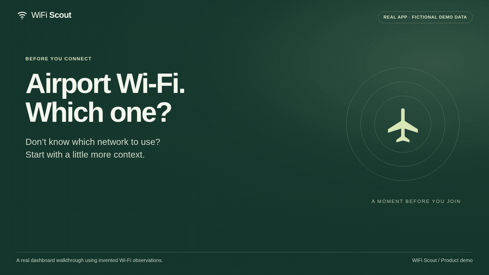

# WiFi Scout

**Understand Wi-Fi observations on your phone before you connect.** WiFi Scout includes a native Android scanning app and an iPhone-compatible report companion. Both show clear concerns first, with technical details you can expand. A separate Linux desktop tool supports advanced capture analysis and offline laboratories.

It never connects for you, verifies an operator, or gives a universal “safety score.” A scan can help you ask better questions at a café, airport, or hotel; it cannot establish that a network is trustworthy.

## Android phone app

**[Download the Android test APK](docs/android/wifi-scout-debug.apk)** · [Android setup, source and limitations](android/README.md)

Requires **Android 10 or newer**. This is a debug-signed development build, not a
Play Store release. Install it on a test phone, then use **Try the demo** without
permissions, or choose **Scan nearby Wi-Fi** for real observations.

The phone flow is **scan → compare → expand details → open Android Wi-Fi settings**.
Mark the networks you have permission and any needed sign-in details to use.
WiFi Scout suggests a candidate only when the available evidence supports one.
You select and join the network through Android's controls.

Android requires precise location permission and the system Location setting
for Wi-Fi discovery. The app does not request GPS coordinates, collect passwords,
store visit history, or use an internet connection. Cached or stale observations
cannot support a fresh recommendation. This first phone version does not perform
the desktop tool's management-frame capture or deauthentication analysis.

Choose **Share report** to export the current observations as JSON for the iPhone
companion. Exporting is explicit: reports include network names, access-point
addresses and timestamps. Up to five exported files remain in the Android app's
private cache; the app otherwise keeps observations in memory.

[Native Android screenshots](docs/android/screenshots/) · [Build validation](docs/android/build-validation.json) · [Emulator validation](docs/android/emulator-validation.json)

## iPhone companion

**[iPhone companion source and setup](iphone/README.md)** · [Browser validation](docs/iphone/verification.json)

Serve the bundled `iphone/` directory from an HTTPS host, open its address in
Safari, then choose **Share → Add to Home Screen**. No build step or backend is
required. The setup guide also includes a local browser preview command.

The [iPhone companion](iphone/README.md) opens reports shared from Android or the
desktop tool in Safari. You can add it to the Home Screen when served over HTTPS.
Use **Open a report**, paste JSON, or try the fictional example; then read the
concerns, expand details, and follow the guide to iPhone **Settings → Wi-Fi**.

Imported observations stay in browser memory and are never uploaded by the app.
The app shell can work offline after its first online load. A prior suggestion is
labelled **Suggested in this report**, alongside its source and observation age.

This is a report companion, not an App Store build or a nearby-network scanner.
iOS does not expose general Wi-Fi scanning to ordinary apps. The companion cannot
verify current conditions or automatically join a network. See the
[platform notes](android/README.md#iphone).

## Desktop walkthrough

[](docs/demo/wifi-scout-demo.mp4)

**[Watch the airport Wi-Fi demo (MP4)](docs/demo/wifi-scout-demo.mp4)** · [Accessible local player](docs/demo/index.html) · [Transcript and reproduction steps](docs/demo/README.md)

*A silent, captioned recording of the desktop browser dashboard using fictional bundled observations. This is separate from the native Android app above. It is not a live airport scan or proof of operator trust. [Dashboard screenshot](docs/screenshots/dashboard-results.png) · [Narrow browser screenshot](docs/screenshots/dashboard-mobile.png).*

## Start with the desktop demo

Requires Python 3.10 or newer. From this checkout:

```sh
python3 -m venv .venv
. .venv/bin/activate
python -m pip install -e .
wifi-scout serve --demo
```

Open **http://127.0.0.1:8765**, then choose **Scan nearby Wi-Fi**. The demo badge stays visible. Demo observations include a normal multi-access-point network, conflicting security advertisements, missing fields, and an unusual management-frame count. They are synthetic examples and do not describe your surroundings.

To see a recommendation in the demo, enter a network name from its results and select the permission/credentials checkbox. The checkbox means that you are authorized and able to join that named network. Matching a venue’s advertised name alone never grants permission or authenticates an access point.

Prefer a terminal?

```sh
wifi-scout scan --demo
wifi-scout scan --demo --json
wifi-scout scan --demo --venue 'Juniper Café' --allow-ssid 'Juniper Café'
```

The application has **no Python runtime dependencies**, account, telemetry, remote API, cloud service, or LLM. Installing Python, system tools, or build dependencies may need internet access; scanning and the dashboard do not. All dashboard assets are bundled locally.

See [tools and custom code](docs/tools-and-custom-code.md) for what comes from
Python, NetworkManager, and Wireshark, and what was written for this project.

## Run the ten-concern lab

```sh
wifi-scout lab --output lab-results
```

Open `lab-results/index.html` to inspect the results, controls, and evidence.
The lab replays synthetic NetworkManager output and generated packet captures
through the production code. Its ten scenarios distinguish six observable risk
indicators, three scan blind spots, and one terminal input-protection check.
Passing all checks does **not** mean ten attacks were detected.

TShark is needed for the native capture case; missing TShark is reported as a
skipped check and an incomplete run. No radio, live attack, or nearby network
collection is involved. See the [lab guide](docs/lab.md) for the ten concerns,
generated artifacts, exit codes, and validation limits.

## Try difficult-observation simulations

```sh
wifi-scout doctor
wifi-scout stress-lab --output stress-results --seed 7
```

`doctor` checks prerequisites without scanning or changing network settings.
The stress lab decodes 13 generated capture scenarios with real TShark,
including crowded observations, changing signal, repeated records, lost events,
short bursts, and missing metadata. Open `stress-results/index.html` for
results and expandable evidence. These are software simulations of observations;
physical radios, drivers, and real RF contention remain untested.

Advanced capture now summarizes signal samples by their median, reports large
variation, removes identifiable duplicate records, and checks for concentrated
disconnect activity inside longer captures. The thresholds remain uncalibrated
heuristics. See the [stress lab guide](docs/stress-lab.md) and
[hardware validation guide](docs/hardware-validation.md).

## Scan on Linux

Install NetworkManager with its `nmcli` command using your distribution’s package manager, ensure Wi-Fi is enabled, and run:

```sh
wifi-scout scan
wifi-scout serve
```

For example, Debian/Ubuntu packages are `network-manager` for ordinary discovery and optionally `tshark` for advanced analysis. Your distribution may already have NetworkManager installed. WiFi Scout does not start, stop, or reconfigure it.

You can choose an interface and specify the name posted by a venue:

```sh
wifi-scout scan --interface wlan0 --venue 'Harbor Café'
```

To include that name among recommendation candidates, explicitly confirm that you have permission and any required credentials:

```sh
wifi-scout scan --venue 'Harbor Café' --allow-ssid 'Harbor Café'
```

Repeat `--allow-ssid` for other networks you are authorized and able to join. It does not provide a password or cause a connection. A nearby private network with stronger encryption is not a candidate unless you explicitly include it. A venue name also narrows the comparison to that exact name.

Normal mode asks NetworkManager for Wi-Fi discovery. **OS scans may transmit probe requests.** WiFi Scout does not inject attack traffic, probe other clients, or automatically connect. An observation timestamp records when the tool obtained a result; ordinary discovery may include NetworkManager’s cached access-point information.

## Reading the results

The dashboard starts with a short takeaway, a practical next step, and visible
concerns in plain language. It groups access points with the exact same visible
Wi-Fi name into one card, while keeping hidden names separate. A shared name
does not establish shared ownership, and conflicting settings remain visible.

Open **Technical details** when you want the underlying measurements, individual
access-point addresses, findings, confidence, and evidence. These sections start
closed. Important warnings and uncertainty about who runs the network remain
visible without opening them. The lab report uses the same approach: readable
results first, expandable methods and evidence underneath.

Every access-point observation has three independent assessments:

| Dimension | What the evidence can tell you | What it cannot tell you |
| --- | --- | --- |
| Wireless security configuration | Advertised open, OWE, WEP, WPA, WPA2, or WPA3 configuration; additional RSN/PMF details when available | Whether the operator is trustworthy or every client negotiates the advertised settings |
| Expected connection quality | A rough signal-based indication at your current location | Internet speed, congestion, captive-portal behavior, reliability, or client isolation |
| Confidence in network identity | Name matches, conflicting advertisements, and differences from an optional previous observation | Whether an access point belongs to the venue or is free of attackers |

**Best observed candidate** is a bounded comparison among eligible observations, with reasons and caveats. It is not an endorsement of the operator. **Cannot confidently recommend** is an expected result when permission, comparable evidence, or other necessary information is missing, or observations need clarification.

Unknown fields stay unknown. Missing PMF data, hidden names, multiple access points using one name, vendor differences, and strong signals are not evidence of an attack. Mesh and enterprise networks commonly use multiple BSSIDs. Names, BSSIDs, and advertised capabilities can be copied or spoofed.

Open Wi-Fi does **not** automatically expose HTTPS contents: correctly validated HTTPS still encrypts application content. Open radio access has other limitations, and unencrypted application traffic may be exposed. OWE/Enhanced Open adds wireless encryption without authenticating the operator. WPA2/WPA3 likewise do not establish operator trust.

Each finding includes a stable ID, severity, confidence, observed evidence, and a plain-language explanation. Read the [deterministic rules](docs/rules.md) for thresholds, ranking, and competing explanations, and the [field reference](docs/tool-fields.md) for what each backend actually measures.

## Optional advanced observations

Advanced mode uses **TShark** and an **already configured, compatible monitor-mode interface**. It can read RSN and PMF advertisements and count relevant management frames observed on the interface’s current channel. Ordinary managed-mode adapters often cannot supply these observations.

Before using it:

1. Obtain permission to observe the network and use compatible hardware/driver support. A separate adapter is recommended so your current connection can stay in place.
2. Configure the monitor interface yourself. WiFi Scout does not change interface mode, select channels, hop channels, stop NetworkManager, or disconnect your existing connection.
3. Install TShark and arrange the distribution’s documented `dumpcap` capture permissions. Do not run the dashboard as root. Capture access is a local system-administration decision.

Then explicitly acknowledge those requirements:

```sh
wifi-scout scan --advanced --interface wlan1mon --duration 15 --acknowledge-monitor
```

Live capture observes frames without injecting traffic. It extracts selected access-point and management-frame fields; it does not save a packet capture, application payloads, or nearby client identifiers by default. A short, single-channel capture misses other channels and many events. Unusual deauthentication counts are observations with alternative explanations, not proof of an attack. Protected or unsupported frames may not be fully decoded.

For an existing capture you are permitted to analyze:

```sh
wifi-scout scan --capture /path/to/authorized-capture.pcapng --json
```

TShark is still required for capture-file analysis. Imported files may already contain sensitive traffic; WiFi Scout does not create or erase their contents. File observations are labeled separately from a live scan. Advanced analysis is available through the CLI; the dashboard offers ordinary discovery or the explicit demo.

## Optional local history

History is **off by default**. A baseline stores normalized access-point observations, including names, BSSIDs, timestamps, and advertised properties. Those records can reveal places you have visited. It contains no Wi-Fi passwords or application payloads.

Use an explicit baseline path in the CLI:

```sh
wifi-scout scan --save-baseline ./previous-visit.json
wifi-scout scan --baseline ./previous-visit.json
wifi-scout history delete --path ./previous-visit.json
```

The dashboard provides separate opt-in controls for comparing a saved visit and saving the current visit, plus a deletion action. Its default location is `$XDG_DATA_HOME/wifi-scout/baseline.json`, or `~/.local/share/wifi-scout/baseline.json` when `XDG_DATA_HOME` is unset. To remove that default baseline:

```sh
wifi-scout history delete
```

Demo observations cannot be saved as a live baseline. A changed configuration may reflect an upgrade, roaming, new hardware, or incomplete coverage. A matching baseline does not authenticate an access point. Deletion removes the selected baseline file; it does not securely erase storage, delete exported JSON, or remove any copies you made.

## Supported platforms and validation

| Capability | Linux | macOS | Windows | Validation in this project |
| --- | --- | --- | --- | --- |
| Live NetworkManager discovery | Implemented; NetworkManager and compatible Wi-Fi required | Not implemented | Not implemented | Parser fixtures and mocked subprocess/error tests; no real wireless hardware validation |
| Live TShark monitor observations | Implemented; existing monitor interface and capture permission required | Not supported | Not supported | Selected-field fixtures and mocked capture tests; no real monitor hardware validation |
| TShark capture-file analysis | Implemented with TShark | No platform support claim | No platform support claim | Real TShark 4.4.19 decoding a generated synthetic PCAP; see field reference |
| Bundled demo and local dashboard | Implemented | Portable Python design; not platform-tested | Portable Python design; not platform-tested | Linux automated tests and local browser checks |

This MVP was built in a Linux environment without a Wi-Fi interface. **No live network results or real-hardware performance claims are included.** TShark 4.4.19 was exercised against invented radiotap frames, including hostile SSID text, RSN/PMF variants, and deauthentication observations. The optional binary integration test skips explicitly when TShark is absent. CI validates deterministic behavior and packaging, not wireless hardware. Contributions with documented hardware/driver/tool versions and consented, minimized fixtures are welcome.

## Privacy and local service

- Runtime operation stays on your machine. There are no external requests, analytics, CDN assets, accounts, or automatic updates.
- The dashboard binds only to `127.0.0.1`. Do not expose it with a reverse proxy or port forward. It is a local utility, not a multiuser server.
- SSIDs are untrusted input: the terminal escapes control characters, the dashboard inserts text safely, and scanner commands use structured argument lists without a shell.
- Scans and comparisons do not persist unless you explicitly request a baseline or redirect/export output. The dashboard’s current results live in memory.
- WiFi Scout does not perform deauthentication injection, password attacks, client probing, traffic manipulation, automatic connection, or NetworkManager shutdown.

See [SECURITY.md](SECURITY.md) for the threat model and reporting guidance.

## Troubleshooting

| Symptom | What to check |
| --- | --- |
| `nmcli` is missing | Install your distribution’s NetworkManager package, or try `--demo`. |
| NetworkManager is unavailable | Check that your system uses NetworkManager and it is running. WiFi Scout deliberately does not start or replace network services. |
| No access points found | Check Wi-Fi/radio state, adapter availability, interface selection, range, and OS permissions. An empty scan is not evidence that the surroundings are secure. |
| Permission denied | Ordinary scans depend on local NetworkManager policy. Advanced capture depends on `dumpcap`/device permissions. Use distribution guidance; do not run the entire dashboard with elevated privileges. |
| Advanced interface rejected | Use a separate, already configured monitor-mode adapter with driver support. A normal connection interface is insufficient. |
| TShark field/version error | Check the [documented fields and requirements](docs/tool-fields.md), update your distribution’s TShark package, or use normal discovery. |
| Cannot confidently recommend | Supply the venue name and explicitly identify networks you may join, then read the missing evidence and findings. Abstaining is intentional. |
| Dashboard port is busy | Choose another loopback port, for example `wifi-scout serve --port 8766`. |
| Baseline is unreadable | Check the path and file permissions. Remove or replace a corrupted baseline with a fresh, opt-in observation. |
| macOS or Windows live scan rejected | These discovery adapters have not been implemented or tested. No live support is claimed. |

`wifi-scout --help`, `wifi-scout scan --help`, and `wifi-scout serve --help` describe the available options.

## Development

```sh
python -m unittest discover -s tests -v
```

Optional browser checks need Playwright and Chromium (development tools only):

```sh
python -m pip install playwright
python -m playwright install chromium
python tests/browser_smoke.py
```

Use `--screenshots` to regenerate the demo screenshots. The browser check starts
its own temporary loopback server, exercises malicious SSIDs and authorization,
and checks that the page makes no external requests.

See [architecture](docs/architecture.md), [contribution guidance](CONTRIBUTING.md), [rule definitions](docs/rules.md), and [official tool field references](docs/tool-fields.md). GitHub Actions runs the tests and builds/installs the package on supported Python versions. The project is licensed under the [MIT License](LICENSE).
